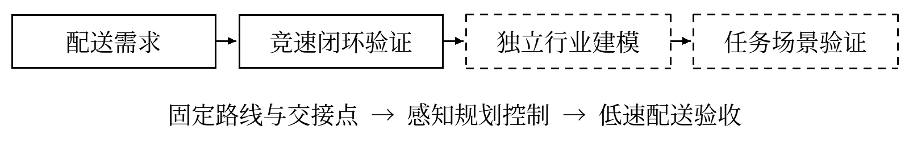
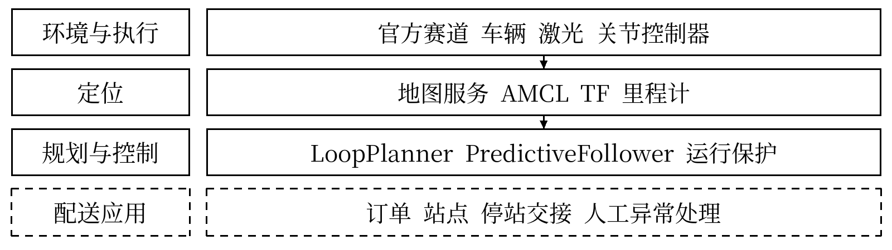
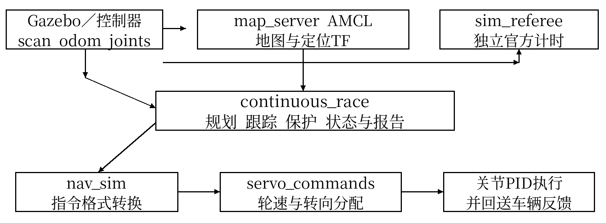
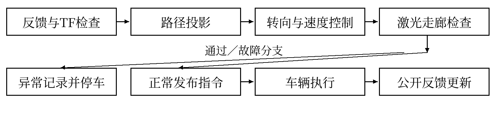
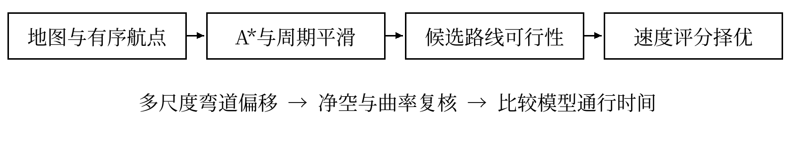
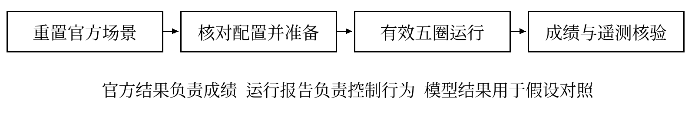

# 2026年 iCAN 大学生创新创业大赛

“集思杯”AI智能无人系统应用创新挑战赛

RoboRacer无人车竞速赛

# 产品技术方案书

项目名称：面向封闭园区轻型物资配送的自主无人车系统

学校名称：xxxxxxxxx

团队名称：xxxxxxxxx

应用方向：智慧物流

版本：V2.0    日期：2026年10月14日

### 方案摘要

本方案面向园区固定站点间的轻型物资配送，以现有ROS竞速系统为技术基础，形成激光感知、地图定位、整圈路线规划、速度包络和连续轨迹跟踪的控制闭环。竞速平台承担高动态导航验证；配送模型与业务任务按行业需求独立设计。现有实现能够支持赛道连续运行、反馈检查和故障停车，行业车辆建模、订单管理及交接任务仍需实现与验证。

团队报告当前最快有效五圈为72秒；已提供的历史裁判截图显示五圈87.546秒。72秒对应的官方结果原件【待补充验证】，一分钟以内仍为研发目标。本方案不把控制器参考闭环、离线模型时间或计划指标作为官方成绩。

正文覆盖应用任务、系统构成、关键技术、竞速优化、仿真验证、技术迁移与应用价值。核心技术事实对应仓库111的main分支快照9d7af98d，核对依据见配套技术事实核对表。

<!-- PDF换页 -->

## 一 项目概述

封闭园区内的文件、备件和小件耗材配送具有路线重复、站点固定、任务分散的特点。人工往返需要持续占用后勤人员，车辆在转弯、窄道和临时障碍附近的操作又依赖驾驶经验。针对这一类任务，本项目设计面向固定站点的轻型物资自主配送无人车，使常规运输按预定路线执行，并在感知、定位或控制异常时停止，交由操作员处置。自主车辆的价值在于承担可重复的移动过程，同时留下可追溯的任务与运行记录。系统以二维激光和里程计获取环境与运动信息，经地图定位确定车辆状态；在安全净空约束下生成平滑路线，结合曲率、转向速率及制动能力规划速度，再通过转向反馈完成连续跟踪。RoboRacer竞速平台用于检验弯道响应、闭环连续性和运行时效，行业任务则在独立建模的低速配送场景中验证停站、交接和异常处置。当前竞速控制已有实现，配送业务层和行业模型按本方案规划，不将竞速完赛直接等同于行业交付完成。

## 二 应用场景与任务定义

### 2.1 应用背景与目标用户

目标用户为高校、科研园区及封闭厂区的后勤运营部门；操作员负责装载、放行与异常处理，收件人负责交接。首期服务可建图、通道可管理、与公共道路隔离的固定路线，不进入开放道路或密集人群。

### 2.2 核心需求

核心需求包括按固定站点自主通行、弯道连续跟踪、临时静态障碍前减速或停车、运行异常可追溯，以及静止交接。路线效率以配送任务完成时间衡量，安全边界按载荷和实车制动测试重新确定，竞速速度不直接用于配送。

### 2.3 无人车任务流程

【规划实现】接收配送任务后检查定位和反馈，完成装载确认与零速转向准备，沿批准路线行驶，到达站点后停车并等待人工确认，再返回或执行下一任务。新增障碍先限速、停车；自动改道和订单管理尚未接入当前竞速控制器。

图1 项目总体技术路线图  虚线框表示规划实现

<!-- PDF换页 -->

## 三 系统总体方案

### 3.1 系统总体架构

本系统采用ROS 1模块化架构。环境层提供官方赛道、车辆与传感器仿真；定位层由地图服务、AMCL及TF组成；规划控制层由整圈规划器和连续控制器承担；执行层将速度、转角转换为Ackermann指令，再驱动轮速与转向关节。配送业务层【规划实现】，与运行保护分离。

图2 无人车系统总体架构图  竞速主链路不启动move_base

### 3.2 软件模块及职责

| 模块或节点 | 输入与处理 | 输出 |
| --- | --- | --- |
| map_server／AMCL | 地图、scan、odom TF；粒子滤波定位 | OccupancyGrid、amcl_pose、map至odom TF |
| continuous_race | 静止规划；速度规划、跟踪和运行保护 | race_path、race_baseline、cmd_vel；状态与报告 |
| nav_sim／servo_commands | 转角语义Twist转换；Ackermann轮速分配 | ackermann_cmd_stamped；六路关节指令 |
| Gazebo及ros_control | 动力学与关节PID执行；反馈发布 | scan、odom、joint_states、TF |
| sim_referee | 独立核验环境和有效圈数 | 官方计时、结果锁定与上报 |

整圈规划器与跟踪器是同一continuous_race节点内的Python模块，并非独立ROS节点。TEB、L1、Follow-the-gap、沿墙行驶及SLAM均保留为独立比较或建图入口；当前最快配置未同时启用这些控制器。

<!-- PDF换页 -->

### 3.3 信息流和接口约定

图3 ROS软件节点与数据交互图  话题均位于tianracer命名空间

连续控制器订阅scan、odom和joint_states，经TF取得map至base_footprint位姿。prepare、start、stop及status使用std_srvs/Trigger；race_path和race_baseline使用nav_msgs/Path。运行控制Twist的linear.x为速度，angular.z在本链路中为转角，nav_sim直接保留该语义。裁判独立观察仿真，不发送驾驶指令。

## 四 关键技术路线

### 4.1 激光环境感知与路线走廊检查

针对弯道前的静态障碍，本系统检查LaserScan元数据和前向有效覆盖率，将测距点按采样时间的TF变换至参考坐标，沿前方路线采样有方向的矩形车体包络。障碍落入包络时计算允许速度；极低限速或无效扫描触发停车。该方法围绕实际转弯路线检查碰撞，避免仅按当前转角延伸直线或圆弧造成不匹配。配送场景可复用此机制处理走廊侵入物，但不具备物体语义识别。

### 4.2 栅格地图约束下的整圈路线规划

针对离散目标导致的重复停车，LoopPlanner在静止状态下读取二维占据栅格，未知区域按障碍处理。距离变换建立净空场，带墙距代价的八邻域A*按有序航点构建闭环，禁止对角穿障。周期高斯平滑和弯道偏移候选均需重新通过净空、转向曲率及航点顺序检查。路线以约4厘米间隔重采样，不跳过规定检查点。行业固定配送路线可据此生成巡回通行轨迹；任意订单目标的通用规划【规划实现】。

<!-- PDF换页 -->

### 4.3 连续轨迹跟踪与转向控制

针对高速转向滞后与左右纠偏，race_feedback采用路径曲率前馈、连续航向反馈和随实测速度归一化的横向误差反馈。转向目标限制在允许角度内，并约束每周期的指令变化；左右转向关节换算为等效实测转角，补偿增益随反馈年龄衰减。几何投影用于横向反馈，单调累计里程用于跨圈进度，避免定位修正被误认为横向偏离。该控制组合是代码中的工程实现，不称为MPC或标准Stanley控制器。

### 4.4 速度规划与响应距离预留

速度上限取直道预算、横向加速度、横摆速率和转角空间变化约束的最小值，再跨闭环传播加速可达性。delayed_braking模式对下游弯道预留一次响应距离，其约束为：

$$d \geq v\tau + \frac{v^2-u^2}{2b}$$

其中v为接近速度、u为下游限速、b为制动预算、τ为响应预留。在线只对实测速度超出计划的部分追加预瞄，避免重复计入同一响应余量。制动预算必须经实车测试确认，τ=0.25秒是配置预留，尚非测得的电机延迟。

### 4.5 静止准备与安全停止

针对发车后才对准转向造成的首弯停顿，prepare服务保持零线速度并预置转角；可选require_prepared_start要求新鲜实测转向就绪后才接受start。起步连接线先做净空检查；提前释放启动限速要求前进至少0.6米、跟踪误差小于2.5厘米、航向误差小于0.05弧度、目标与实测转角差小于0.05弧度，并持续0.3秒。scan、odom、TF以及本配置所需关节反馈超过时效、出现非有限值或越过安全边界时停车并记录故障，恢复须检查现场和重新准备。

图4 自主导航与竞速控制流程图

<!-- PDF换页 -->

## 五 针对RoboRacer的核心技术优化

### 5.1 路径规划精度与路线选择

路线搜索以预测通行时间比较可行候选，联合考察路线长度、曲率和速度包络。line_search_level=2扩大多尺度弯道细调，但仍固定赛道拓扑，并保护起点后6米区域及跨圈接缝附近区域。模型评分不包含起步损失，不能直接作为成绩。

### 5.2 弯道处理与高速跟踪

弯前制动、曲率前馈和实测转向补偿协同工作；转向未对准、航向误差增大或向走廊边界漂移时连续降低速度。首弯的效率取决于实际反馈与启动限制释放，增大yaw或起步加速度并不保证更快。

### 5.3 静态障碍的实时处理

已有实现为地图约束路线选择及激光走廊碰撞规避，通过限速或停车阻止继续接近障碍。运行中自动生成绕障新路线【规划实现】，不能把安全停车描述为已经绕障通过。

### 5.4 跨圈控制与速度稳定性

控制器保持闭合轨迹和累计进度，跨圈不重置起步对齐。加速命令受预算限制，风险限速优先于提速；speed_recovery_hold可配置风险降速后的加速等待，72秒基线取0。0.34米路线净空、0.23米墙距停车及0.15米参考偏差停车分别使用不同几何量，不能相减后作为统一误差余量。

### 5.5 实时性与计算资源

复杂路线搜索在发车前完成，运行控制目标频率50Hz。走廊碰撞计算采用批量采样和保守包围框过滤；报告快照后台写入，最终stop保存完整报告。CycleTiming分别记录计算墙钟耗时和仿真周期，不能据目标频率声称每台机器均达到稳定实时运行。

图5 路径与速度联合优化核心算法流程图

<!-- PDF换页 -->

## 六 仿真验证方案与结果

### 6.1 仿真环境与主要参数

官方初赛采用ROS2GO统一环境，Ubuntu 20.04、ROS Noetic与Gazebo 11。当前竞速入口为race_tuning_demo，使用tianracer_racetrack赛道及规定车模。地图分辨率0.025米；模型激光40Hz、1081束、270°视场、量程0.1～10米；关节反馈配置50Hz，里程计适配器20Hz。模型中的相机和IMU存在，但连续竞速决策没有直接订阅其图像或IMU话题。

| 参数组 | 团队报告72秒对应配置 |
| --- | --- |
| 速度规划与横向控制 | delayed_braking；race_feedback |
| 运动预算 | lateral_accel=10.5 m/s²；acceleration=7.0 m/s²；braking=3.6 m/s²；yaw_rate=3.8 rad/s |
| 起步设置 | startup_speed=2.0 m/s；startup_acceleration=2.5 m/s²；startup_release_early=true |
| 转向与误差反馈 | steering_feedback_gain=0.25；steering_preview_time=0.12 s；heading/cross_track增益均为0.8 |
| 路线与其余设置 | line_search_level=2；predict_pose=false；speed_recovery_hold=0.0 s |
| 保留保护 | max_speed=10 m/s上限；response_delay=0.25 s；净空0.34 m；墙距0.23 m；偏差0.15 m |

上述参数为复现实验配置，不代表已校准的物理极限。正式试验先核对运行参数、节点唯一性与参考路线指纹，再静止prepare、等待转向就绪、由裁判准备并调用一次start。裁判锁定5/5后stop保存报告；发生碰撞、翻车或保护停车立即终止该轮。

图6 仿真验证与证据核验流程图

<!-- PDF换页 -->

### 6.2 测试场景与指标

直道测试加速、实测速度和指令跟随；弯道测试入口速度、最低速度、恢复时间及参考偏差；静态障碍测试净空可行性、雷达限速与停车；跨圈和五圈测试连续性、官方有效圈数和总时间。反馈失效、时钟回退及非有限数据通过开发测试覆盖。行业配送测试【待补充验证】，需另行验证装载、到站和交接。

### 6.3 已有验证结果与证据层级

| 证据类型 | 可引用结果 | 解释及限制 |
| --- | --- | --- |
| 历史裁判截图 | 5/5；87.546 s | 各圈19.224／16.963／17.082／17.044／17.233 s |
| 当前团队报告 | 最快有效五圈72 s | 对应官方原件、各圈及本轮遥测【待补充验证】 |
| 历史Gazebo报告 | 五个参考闭环96.630／94.231／92.679 s | 旧预算下三组单次试验；均last_fault=null；非官方成绩 |
| 当前假设模型 | 150 ms响应、20 ms位姿年龄：73.32／71.30 s | 定位补偿关／开；模型非Gazebo，不能证明实测收益 |
| 模型反例 | 80 ms响应、20 ms位姿年龄：69.48／72.78 s | 补偿反而变慢，不能宣称普遍有效 |

历史Gazebo报告最大参考偏差依次为0.1322、0.1114、0.1135米，单次结果不能证明稳定完赛率。仓库当前模型报告标记gazebo_tested=false、official_under_60_verified=false；这不否定旧版Gazebo测试，但说明新配置尚缺相同层级的物理仿真证据。

### 6.4 最终实测记录要求

【待最终实测填入】本轮官方五圈时间、各圈时间、碰撞与翻车观察、last_fault、最大偏差及周期耗时。控制报告始终保留official_result=false；官方有效性须以裁判绑定、合规环境和原始结果核验，不手动修改该字段。reason、道路、阶段、圈别统计存在交叉归属，不简单相加。

## 七 技术创新点

第一，针对最短路径未必最快的问题，将模型速度约束纳入可行路线比较，形成路线与速度联合优化。第二，针对响应余量重复限速的问题，将延迟制动写入闭环空间包络，并以实测超速量补充在线预瞄。第三，针对首弯转向未就绪和跨圈重复起步的问题，组合静止准备、实测转向核验与一次性启动释放。上述特点属于现有模块的竞速工程改进，实际收益仍按相同预算对照验证，不作原创算法或领先性声明。

<!-- PDF换页 -->

## 八 从竞速系统到实际应用的技术迁移

RoboRacer作为高动态自主移动技术验证平台，检验路线连续性、弯道跟踪、响应距离和运行保护。迁移至园区配送后，整圈赛道改为固定站点巡回路线，模型速度评分改为任务通行时间与停站成本评估，路线走廊检查用于临时障碍前停车，运行报告用于任务异常追溯。

【规划实现】建立独立行业车模与配送世界，增加任务状态机、站点管理和人工交接接口。状态链为待命、装载确认、导航、到站停车、交接、返回；异常转入停止与人工处理。行业初始测试限速目标为直道不高于1.2米/秒、弯道不高于0.8米/秒，仍须依据载荷和制动校准确定。任务成功率目标≥95%、到站纵向误差目标≤0.20米，均为设计验收值，尚无实测。

## 九 工程实现与落地方案

### 9.1 软件部署与计算平台

仿真采用catkin工作空间部署Python规划控制模块和ROS节点，启动后核对包路径和参数，避免旧工作空间覆盖。实车计算平台【待补充验证】，可按算力、接口和供电约束选型；仓库列举的Jetson系列不等于本队已经装备。部署前核对ROS依赖、权限、驱动版本和传感器TF。

### 9.2 实车接口与迁移条件

仓库包含TianBoard串口协议源码、激光与相机驱动入口、IMU滤波和里程计EKF配置；当前core launch实际调用外部tianbot_core。实车通过AckermannDrive对接底盘，需核对转角单位、轮距、轴距及反馈接口。通用cmd_vel转换器将angular.z解释为角速度，与当前竞速转角语义不同；应设计专用桥接并加入命令过期停车，不直接串接或沿用无限重发缓存。

### 9.3 独立建模与验证步骤

【规划实现】团队自行建立配送车URDF、载荷惯量、碰撞几何及Gazebo场景，记录模型来源和建模过程。先验证低速直行与零速转向，再测转向、制动和反馈延迟；之后开展固定站点任务、障碍停车及连续任务测试。官方竞速模型只作为指定验证平台，不作为团队自主行业建模成果；公共软件和模型按原许可证引用。

实车验收前测量车辆外形、轴距、驱动电机数、电池和雷达规格，并对照规则检录。仿真里程计适配器以Gazebo link_states生成反馈，属于现有仿真链路；实车必须更换为底盘里程计及相应定位反馈，且需核对官方仿真适配器的允许版本。

<!-- PDF换页 -->

## 十 预期应用价值

### 10.1 技术与工程价值

系统将路线生成、速度约束和转向反馈组合为可检查的连续闭环，便于定位效率损失发生在规划、执行器或定位环节。将复杂搜索移至静止阶段，并保留运行故障和周期诊断，有助于在有限算力条件下调试和复现。不同控制入口的明确隔离，也为课程实验和算法对照提供工程基础。

### 10.2 应用价值与推广边界

在固定站点、通行区域可管理的园区，预期以自主运输减少人员重复往返，并通过任务状态和运行记录支持后勤调度。收益需与人工配送对照，以任务总时长、人工介入次数、空驶距离、能耗和故障恢复时间评价。当前没有客户订单、商业收入或成本节约实测，不给出投资回报率承诺。

### 10.3 落地验收与阶段安排

| 阶段 | 工作内容 | 验收证据 |
| --- | --- | --- |
| 竞速复验 | 保留最快有效配置，单变量对照 | 官方5/5、原始时间、无碰撞翻车及保护停车 |
| 行业建模 | 独立车模、配送通道与固定站点 | URDF／世界文件、建模说明、仿真截图 |
| 业务接入 | 任务状态机、停站和人工交接 | 任务日志、到站误差、异常处理记录 |
| 低速实车 | 底盘桥接、反馈校准、载荷制动 | 配置清单、实车照片、制动及反馈测试报告 |

本方案以已有竞速规划与控制为基础，将成熟的通行闭环逐步迁移至低速配送任务。下一阶段应优先补齐官方成绩原件、独立行业模型和任务演示证据，再依据验证结果确定产品运行边界。

### 参考资料

[1] 组委会发11号通知，作品提交要求与评审说明，第2—5、7页。

[2] RoboRacer无人车竞速赛竞赛规则，初赛平台、五圈判定及实车限制。

[3] taylorcelia571-maker/111，main快照9d7af98d；规划、跟踪、接口与验证代码。

[4] USER72_CURRENT_TUNING_CN.md、USER72_CURRENT_MODEL_RESULTS.json、GAZEBO_STARTUP_RESULTS.json及对应说明。

[5] Tianbot Tianracer、HyphaROS RaceCar及Lord-Z ackermann_gazebo，平台与资源来源；仓库根LICENSE为GPLv3，个别包许可证字段尚需核对。
